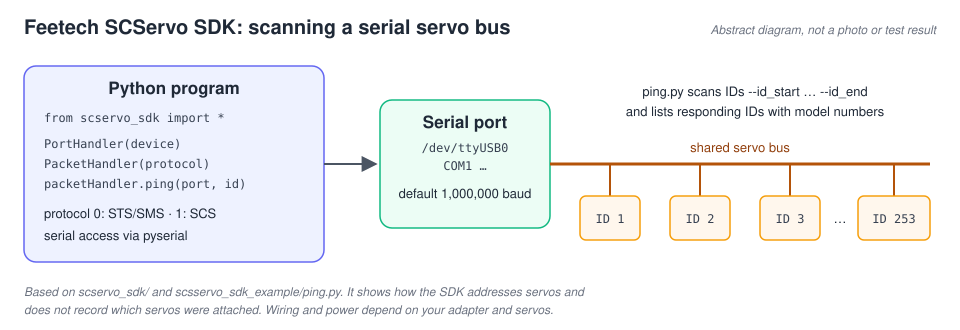

# Feetech-Servo-SDK

[](scservo_sdk)
[](#this-copy-id-range-scanning-in-pingpy)
[](LICENSE)



*Abstract diagram of how the SDK and `ping.py` address servos. It is not a photo and does not record a hardware test.*

This is source code from [official feetech repository](https://gitee.com/ftservo/SCServoSDK).
The repository structure copies the structure of the [original library](https://gitee.com/ftservo/SCServoSDK/blob/e4d07f43c4c34827b2e226cf5cc706576504ebeb/SCServo_Python_200831.7z)

## This copy: ID-range scanning in `ping.py`

This repository ([twerdster/Feetech-Servo-SDK](https://github.com/twerdster/Feetech-Servo-SDK)) copies
[Adam-Software/Feetech-Servo-SDK](https://github.com/Adam-Software/Feetech-Servo-SDK). Its
`scsservo_sdk_example/ping.py` adds command-line options, scans a range of servo IDs, colours the
output and prints a summary of the IDs and model numbers that answered:

```
python3 ping.py --device /dev/ttyUSB0 --baudrate 1000000 --protocol 0 --id_start 1 --id_end 253
```

`--protocol` is `0` for STS/SMS servos and `1` for SCS servos. Without `--device`, the script uses a
macOS USB-serial path (`/dev/tty.usbserial-21240`) that you will usually need to change. The upstream
usage instructions and their recorded output are kept below unchanged; they describe the original
single-ID `ping.py`.

## Structure

```
root dirrectory
     |---scservo_sdk 
     |---scsservo_sdk_example
```
The `scsservo_sdk_example` directories contain examples of using the library.

The source code of the library is located in the `scservo_sdk` directory.

The `scsservo_sdk_source` directory contains the original archive with the source code of the library from the developer.

## Usage

Tested on `Linux raspberrypi 5.15.61-v8+ #1579 SMP PREEMPT Fri Aug 26 11:16:44 BST 2022 aarch64`.
Python version `Python 3.9.2`.

### Method 1. Clone repositry

```
$ cd /usr/src/
$ sudo git clone https://github.com/Adam-Software/Feetech-Servo-SDK.git
$ sudo chown -R pi Feetech-Servo-SDK
$ cd Feetech-Servo-SDK/scsservo_sdk_example
$ python3 ping.py
Succeeded to open the port
Succeeded to change the baudrate
[ID:001] ping Succeeded. SCServo model number : 1540
```

### Method 2. Install pip package

Copy the sample file to any location convenient for you. In the example I use `/home/pi/FeetechTestFiles`

```
$ pip install feetech-servo-sdk
$ cd /home/pi/FeetechTestFiles
$ python3 ping.py
Succeeded to open the port
Succeeded to change the baudrate
[ID:001] ping Succeeded. SCServo model number : 1540
```
